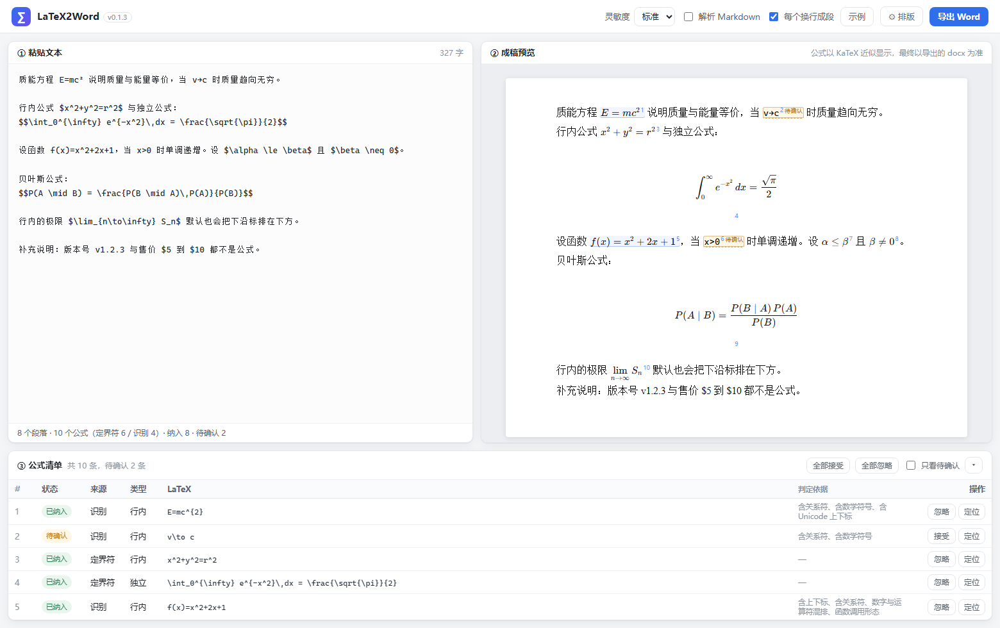

# LaTeX2Word

把「含 LaTeX 公式的文本」贴进去，导出一份公式已经是 **Word 原生公式（OMML）** 的 docx。
公式在 Word 里可以继续双击编辑，不是图片、也不是一行 LaTeX 源码。



## 它解决什么

- 从 AI 对话、Markdown 笔记、PDF 里复制出来的段落，公式常常混着 `$…$`、`$$…$$`，甚至**根本没有定界符**（`E=mc²`、`f(x)=x^2`、`α ≤ β`）。
- Word 自己不认 LaTeX。这个工具负责把两者接上：识别 → 归一化 → LaTeX 转 OMML → 写进 docx。
- 识别出来的公式不是「一律照单全收」，中置信的会标成**待确认**，点一下（或一键全接受）才写进文档。

## 快速开始

1. 双击 `start.cmd`（首次运行会自动建虚拟环境并安装依赖，需要联网，约 1-2 分钟）。
2. 浏览器打开 `http://127.0.0.1:8765/`（端口被占用会自动顺延，控制台窗口会打印实际地址）。
3. 粘贴文本 → 右边实时预览 → 点「导出 Word」。

环境要求：Windows + **Python 3.10 以上** + **本机装了 Microsoft Office**（要用 Office 自带的 `MML2OMML.XSL` 做 MathML→OMML）。不需要装 TeX、不需要联网转换。

## 装了多个 Python 怎么办

启动器会自己找，**不用敲命令**：

1. 按 `py -3.16 … 3.10`、PATH、注册表、常见安装目录依次探测，每个候选都实际跑一遍确认「能用且 ≥ 3.10」；
2. 只找到**一个** → 直接用，不打扰；
3. 找到**多个** → 弹原生对话框，列出「版本 / 位数 / 来源 / 路径」，默认选中最高版本，回车即可；也可以点「浏览其他 python.exe…」自己指定；
4. 选择记在项目根目录的 `python.txt` 里，下次启动直接复用；
5. 一个都找不到 → 弹出说明框，提供「浏览 python.exe」「打开下载页」「复制诊断信息」。

装好之后想换版本，有两个图形入口（都不用命令行）：

- 网页里「⚙ 排版」→ **运行环境** → 「切换 Python…」，选完自动重启服务；
- 双击项目根目录的 **`选择 Python.cmd`**，下次启动生效。

命令行方式仍然保留，方便脚本化：`start.cmd --select`（重选）、`start.cmd --python <路径>`（指定）、`set LATEX2WORD_PYTHON=<路径>`（临时覆盖）。

如果 `.venv` 是用旧版本 Python 建的、或者那个 Python 已被卸载，启动器会自动把 `.venv` 改名为 `.venv.broken-<时间戳>` 再用新解释器重建，不会删你的数据。


## 功能

| 能力 | 说明 |
|---|---|
| 显式公式 | `$…$`、`$$…$$`、`\(…\)`、`\[…\]`、`\begin{equation}` / `align` / `cases` / `matrix` 等环境 |
| 隐式公式 | 无定界符自动识别：`E=mc²`、`f(x)=x^2+2x+1`、`\frac{a}{b}`、`α ≤ β`、`x>0`… |
| 裸参数写法 | `\frac1 2`、`\frac12`、`\frac1x`、`\sqrt 2`、`\sqrt[3] 8`、`\binom n k` 按 TeX 语义各取一个 token，带不带 `$` 都支持 |
| 选择性复核 | 每条公式可单独接受/忽略，也可「全部接受 / 全部忽略 / 只看待确认」 |
| 币种防误判 | 售价 `$5 到 $10` 不会被当成公式；版本号、日期、区间、网址也不会 |
| Markdown 结构 | 开关控制：`#` 标题、`-` 列表、`>` 引用、表格、代码块（代码块内不做公式识别） |
| 排版可配 | 中/西文字体、字号、行距、首行缩进、页边距、纸张，设置存在浏览器本地 |
| 上下限位置 | 设置里可选：**一律排下方**（默认，行内也排下方）/ **跟随 LaTeX 惯例**（行内右侧、独立下方）/ **一律排右侧**；作用于 `lim` `max` `min` `sup` `∑` `∏` 等，积分上下限按惯例始终在右侧 |
| 大型运算符尺寸 | 设置里可选：**自动**（默认，操作数含分式/根式时才用固定尺寸）/ **一律固定** / **跟随内容**（Word 原生，会被撑大）；积分不参与 |
| 质量可见 | 转换失败的公式保留原文并高亮，清单里给出原因，不静默丢内容 |

## 工作原理

```
文本 → 分块（段落/标题/列表/表格/代码）
     → 显式定界符扫描（跨行公式不会被拆散）
     → 剩余片段做隐式识别（种子 → 生长 → 打分 → 语法体检）
     → 归一化（Unicode→LaTeX、align→array、抽 \tag）
     → LaTeX --latex2mathml--> MathML --MML2OMML.XSL--> OMML
     → python-docx 组装（公式直接注入段落）
```

隐式识别的关键不在「认出来」，而在「不乱认」：

- 打分：LaTeX 命令 +5、关系符 +3、上下标 +3、数学符号 +2、函数调用 +3 …
- 扣分：汉字混入、网址、日期、版本号、数值区间、括号不配对 …
- 边界：遇到两个相邻英文词、汉字、句读就停（所以 `the value is x = 2` 只会认 `x = 2`）
- 三档灵敏度只改阈值：保守 / 标准 / 激进

判定规则表见 [docs/DETECTION_RULES.md](docs/DETECTION_RULES.md)，设计稿见 [docs/DESIGN.md](docs/DESIGN.md)。

## 目录

```
app/
  server.py            FastAPI 服务（/api/health /api/analyze /api/export /api/environment）
  core/
    ir.py              文档中间表示（为「导入 Word」预留）
    segmenter.py       分块
    detector/          explicit.py 定界符 / implicit.py 隐式识别
    unicode_math.py    Unicode 数学符号 ↔ LaTeX
    normalize.py       LaTeX 归一化
    mathconv.py        LaTeX → MathML → OMML（带缓存与引擎自检）
    docx_writer.py     IR → docx
    docx_reader.py     【预留】docx → IR
  web/                 前端（原生 JS + 内置 KaTeX，无构建步骤）
scripts/
  find-python.cmd      候选枚举 + 探针 + 选择（纯批处理，无 PowerShell 依赖）
  picker.ps1           WinForms 选择框 / 找不到时的提示框（UTF-8 + BOM）
  menu.py              PowerShell 不可用时的控制台菜单
samples/               示例输入
out/                   示例导出结果（paper-demo.docx、markdown-demo.docx）
tests/                 pytest，116 个用例
docs/                  设计稿、规则表、截图
bootstrap.py           启动引导（校验/重建 .venv、装依赖、拉起服务）
start.cmd              一键启动
选择 Python.cmd         图形化切换解释器
```

## 开发

```powershell
# 安装开发依赖
.venv\Scripts\python.exe -m pip install -r requirements-dev.txt

# 跑测试（116 个）
.venv\Scripts\python.exe -m pytest tests -q

# 只跑识别规则
.venv\Scripts\python.exe -m pytest tests/test_detector.py -q

# 手动启动（可指定端口）
.venv\Scripts\python.exe -m app.server 8765
```

测试覆盖：定界符、`$` 金额歧义、隐式识别正反例、灵敏度分级、Markdown 分块、40 条公式的转换语料、docx 内 OMML 注入、HTTP 接口、解释器候选排序与 `.venv` 校验。

## 已知限制

- **依赖本机 Office**：没有 Office 就找不到 `MML2OMML.XSL`，页面顶部会提示。可把该文件放到 `app/resources/` 或在环境变量 `LATEX2WORD_XSL` 里指定路径。
- 表格单元格内暂不做公式识别（单元格按纯文本写入）。
- 绝对值竖线：裸 `|…|` 与 LaTeX 一致是文字高度、不随内容伸缩；要包住分式这类高内容请写 `\left|…\right|`。
- `\left( … \right)` 里若只有一个二元运算符（如 `\left(a-b\right)`），微软 XSL 会把它转成 `m:d` 的分隔符，视觉上一致但结构上不算标准，暂未处理。
- `\newcommand` 宏定义不展开；宏定义依赖重的文档建议先自行展开。
- Markdown 的行内强调（`**加粗**`、`` `代码` ``）不转成 Word 样式，只保留原文。
- 本版（v0.1.1）不含公式自动编号，也不含「导入 docx」。
- 解释器探测靠 `py` 启动器 / PATH / 注册表 / 常见目录，装在注册表和 PATH 之外的绿色版需要手动「浏览 python.exe」指定。

## 路线图

- v0.2：导入 docx（OMML → MathML → LaTeX），复用同一套 IR 与排版
- v0.3：公式自动编号与交叉引用、表格内公式
- v0.4：可选的可执行文件打包（免装 Python）

## 版本

- v0.1.0 —— 首个可用版本：显式/隐式识别、选择性复核、OMML 原生公式导出、可配置排版
- v0.1.1 —— 多版本 Python 支持：7 级候选探测、原生选择对话框、环境变量/配置文件覆盖、`.venv` 自动备份重建、网页内切换解释器
- v0.1.2 —— 极限排版修正：独立公式里 `\lim` / `\max` 等的下标排到正下方（行内仍保持右侧）；裸函数名自动补反斜杠；整段只有一条识别公式时按独立公式排版
- v0.1.3 —— 上下限位置可选：一律下方（默认）/ 跟随 LaTeX 惯例 / 一律右侧，作用于 `lim` 系列与 `∑` `∏`，预览与导出一致
- v0.1.4 —— 修复导出后极限制的"虚线空框"：下沿标改为在 MathML 层用 `munder` 交给微软 XSL 生成，`m:limLow` 结构合法（此前手工拼接时把 `m:sub` 塞进了 `m:lim`，部分 Word/WPS 版本会渲染成空参数）
- v0.1.5 —— 修复绝对值竖线错位：裸 `|` 不再被 MML2OMML 配成一对括号（那会把整条公式包进一根大竖线），改为普通字符；`\left|…\right|` 仍保留可伸缩的括号结构
- v0.1.6 —— 大型运算符尺寸可选：自动（操作数含分式/根式时用固定尺寸，默认）/ 一律固定 / 跟随内容；解决 `\sum` 被高个儿分式撑到四五倍字号的问题
- v0.1.7 —— 排版设置改版：弹窗加宽到 680px，配置分为「字体、段落与页面」「公式格式」「运行环境」三组；公式格式的选项说明从下拉框移到标签旁的小问号气泡里（悬停或键盘聚焦显示）
